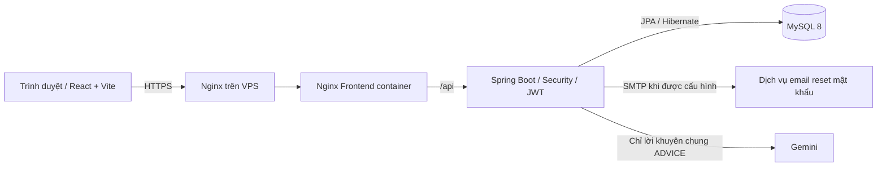
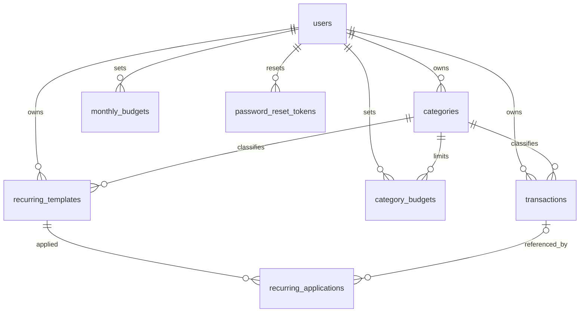

# SmartExpense 2.0 — Bàn giao kỹ thuật, cập nhật 18/11/2026

## Phiên bản và phạm vi

Phiên bản tích hợp đối chiếu: `dev 88be77a3a582f0f5b5654ed66ae70270783d80a1` (PR #77). BE `d771331`, FE `d8dd82b` và DB/QA `e8b785b` đã merge. Baseline `243c9c2` là lịch sử trước đợt sửa, không phải bản dev hiện tại.

D16–D18 gồm gia cố, hồi quy và bàn giao kỹ thuật. Source đã tích hợp và CI/CD SUCCESS; chưa đồng nghĩa nghiệm thu đủ tài nguyên VPS, backup production hoặc email reset thực tế. Cập nhật ngày 18/11 chỉ sửa tài liệu; không phát sinh lượt test, deploy, schema hoặc endpoint mới.

## Kiến trúc hiện có

Backend tổ chức Controller → Service → Repository → MySQL. React dùng REST/JSON qua `/api`; Nginx phục vụ bản build và proxy API. Cấu hình Compose không publish cổng MySQL/Backend; Frontend bind loopback mặc định. Topology này được đọc từ repository, chưa phải kiểm tra SSH trực tiếp trên VPS trong đợt này.

Dashboard, Calendar và Reports tổng hợp từ `transactions`; không có bảng lưu riêng từng biểu đồ. Reports tối đa 6 tháng, tháng rỗng được trả đủ; CSV xuất các giao dịch phù hợp bộ lọc, không phải ảnh biểu đồ hay bảng tổng hợp tháng.

## Dữ liệu và ERD

8 bảng được ánh xạ từ Entity hiện tại. `recurring_applications.transaction_id` có thể null sau khi giao dịch bị xóa; marker vẫn ngăn áp dụng lại cùng kỳ. ERD thể hiện FK thực, không giả định unique cho `transaction_id`.

- Tiền: MySQL `DECIMAL(15,2)` và Java `BigDecimal`.
- Index giao dịch: `(user_id, transaction_date)` phục vụ lọc theo chủ sở hữu/ngày.
- Unique ngân sách tháng: `(user_id, year, month)`.
- Unique ngân sách danh mục: `(user_id, category_id, year, month)`.
- Unique lượt áp dụng mẫu: `(template_id, year, month)`.
- Email và hash token reset có ràng buộc unique tương ứng.
- Chuỗi schema kiểm thử: `d06-legacy-schema.sql` (MVP) → V002 → V003 → V004 → V005 → V006. Repository không có file V001; không tự tạo thêm migration hoặc tuyên bố đã áp production.

## Auth, reset và dữ liệu tài khoản

JWT ký HS256, kiểm tra chữ ký, thời hạn, subject dương và `auth_version` của User qua một scalar SELECT. Sau reset, version tăng trong cùng transaction đổi mật khẩu; token cũ bị từ chối. Mật khẩu băm BCrypt. Logout hiện tại xóa phiên phía client, không phải API revoke riêng.

Reset token ngẫu nhiên 32 byte; DB chỉ lưu SHA-256 hash, hạn 30 phút và dùng một lần. Forgot theo IP 10 lần/15 phút, theo hash email 3 lần/15 phút; reset theo IP 30 lần/15 phút. Limiter/hàng đợi ở từng instance, không phải giới hạn phân tán. Gửi SMTP sau commit, timeout/hàng đợi có giới hạn; phản hồi forgot chung không chứng minh thư đã tới hộp thư.

Financial intents SUMMARY/CATEGORIES/BUDGET/COMPARISON/CATEGORY_TREND dùng số liệu nội bộ và formatter. Chỉ ADVICE gọi Gemini; provider dùng prompt tư vấn chung, không gửi context tài chính, email, JWT, ghi chú hay câu hỏi gốc. Không dùng `/api/ai/chat` làm nguồn KPI.

## Cảnh báo ngân sách và hiển thị

So sánh ngưỡng bằng tiền chính xác trước làm tròn phần trăm. Monthly `exceeded=true` chỉ khi spent > limit. Category DTO giữ `OVER_BUDGET` khi spent >= limit, nhưng `exceeded=false` tại đúng hạn mức; FE phân biệt chạm hạn mức với vượt thật. Không đổi API/schema để thêm trạng thái UI.

## Cải tiến D16

- Robot: giữ lazy import Three.js; không tự tải khi tab ẩn, Save-Data hoặc reduced motion. Tương tác trực tiếp vẫn có thể kích hoạt robot; SVG sẵn trong lúc chờ hoặc khi WebGL không khả dụng. Scene vẫn dừng animation khi ẩn và dispose khi unmount.
- Giao dịch: sửa VND formatter vốn mặc định 0 chữ số thập phân; giữ tối đa 2 chữ số trên tổng trang, desktop/mobile và hộp xác nhận.
- Định kỳ: bỏ `Math.round` trên tiền; thẻ và preview giữ tối đa 2 chữ số.
- Backup/restore: thực thi Docker trực tiếp bằng ProcessStartInfo và luồng byte; đường dẫn không qua cmd. Validate tên DB/container, backup InnoDB với `--single-transaction --quick`, chỉ công bố file sau thành công, lỗi không in cấu hình kết nối.

## Kết quả và giới hạn đã xác minh

| Phạm vi | Kết quả | Phiên bản/giới hạn |
| --- | --- | --- |
| Backend local | 1.279 PASS, 48 suite, 0 fail/error/skipped | Lượt ngày 17/11 trước commit d771331; đọc từng testcase XML |
| D03 MySQL gate | 55/55 PASS | Tập con Backend |
| Frontend local | 617 PASS; lint/build PASS | Cùng source production với commit d8dd82b |
| FE targeted trước commit | 12 PASS; lint PASS | Tập con Frontend, không cộng thêm |
| Script backup/restore | 22 PASS | Windows PowerShell 5.1, MySQL container riêng |
| HTTP/SQL/restore | 13 PASS | JAR build mới của BE đã chốt; 8 bảng checksum khớp |
| Browser history | 84 + 5 PASS | 70 tổ hợp layout/14 luồng; 5 ca build loading/503/Retry/keyboard; chưa chạy lại trên production |
| Public HTTPS smoke | 8 PASS | GET không đăng nhập; không chứng minh đầy đủ luồng nghiệp vụ/container health |

Các nhóm là tập con hoặc lượt khác nhau, không cộng thành tổng. Backend 1.272 là kết quả cũ trước sửa Sonar. JaCoCo overall line 97,3314%, branch 89,6552%; Sonar New Code Coverage 95,3%, duplication 0,0%, New Issues 0. Quality Gate OK theo analysis ID `071fc5ee-b9c8-4b27-8453-e2ec8849977e`; không đánh đồng BUILD SUCCESSFUL của scanner với kết quả gate.

Bốn issue được Sonar tự xác nhận CLOSED/FIXED. CSRF `java:S4502` vẫn OPEN (Vulnerability/Security HIGH): source dùng JWT Bearer chủ động qua header, stateless, không cookie/session auth; test cookie/query/session thay Bearer bị từ chối và CORS được kiểm chứng. Đây là review có điều kiện; phải đánh giá lại nếu thêm cookie/HTTP Basic/credential tự gửi. Không tự chuyển trạng thái issue hoặc hạ gate.

[CI SUCCESS của 88be77a](https://github.com/ToAnhTuan1806/personal-finance-management/actions/runs/44107981081) gồm Backend Test & Build, Frontend Lint & Build và Docker Packaging Check. [CD SUCCESS của cùng SHA](https://github.com/ToAnhTuan1806/personal-finance-management/actions/runs/44107981199) là workflow tự chạy sau merge; agent chỉ đọc trạng thái, không tự trigger deployment. CI và CD hiện độc lập, không suy ra CD luôn chờ CI.

Build FE còn cảnh báo chunk lớn (~1089 kB main, ~541 kB robot trước gzip). Browser history không phải audit WCAG hoặc Chrome headed mới; SMTP mailbox và Gemini Live không suy ra từ tests/provider mocks. Fixture local dùng dữ liệu giả và đã dọn; không dùng database/VPS production làm test target.

## Kiểm tra vận hành và rollback

1. Code BE/FE/DB đã merge; rà nội dung bàn giao và các điều kiện còn thiếu trước khi ký nghiệm thu. Các thay đổi tài liệu cần CI/review riêng khi được push/merge; CI code cũ không tự xác nhận commit tài liệu mới.
2. Người phụ trách kiểm tra container health, CPU/RAM/disk, HTTPS và image digest thực tế trên VPS. Pipeline SUCCESS không thay cho việc đọc trạng thái môi trường.
3. Xác nhận SMTP gửi tới mailbox kiểm soát được; thử reset token một lần/hết hạn và đăng nhập theo kịch bản an toàn. Chưa có bằng chứng hoàn tất bước này trong đợt QA đã ghi.
4. Chốt backup MySQL đúng môi trường, checksum và retention; restore diễn tập trong container cô lập. Ghi image digest trước/sau và phương án tương thích schema, không tự suy đoán production đã chạy migration.
5. Nếu lỗi: dừng phát hành và rollback ứng dụng bằng digest đã duyệt. Restore DB cần dừng ghi, kiểm tra đúng đích và chấp thuận rủi ro mất dữ liệu sau backup; không thử dump trên DB thật. Chưa cam kết zero-downtime hoặc RPO/RTO.

## Kế hoạch xoay secret

Không ghi giá trị secret vào tài liệu. Inventory riêng DB credentials, JWT key, SMTP credentials, Gemini key và deploy token. Người quản trị xác định secret nào thực sự từng lộ, quyền sử dụng và dịch vụ phụ thuộc. Chuẩn bị khóa mới trong kho secret của môi trường, lên lịch cập nhật dịch vụ và healthcheck, thu hồi khóa cũ, xác minh log không lộ giá trị. Xoay JWT sẽ làm phiên cũ mất hiệu lực; thông báo trước. Chỉ thực hiện trên VPS theo phê duyệt riêng; đợt này chưa xoay khóa.

## Bằng chứng

Các báo cáo ngày đã commit được dẫn tại [mục lục QA](../qa/README.md). Báo cáo D16_D18.md và evidence mới hiện còn local ở worktree DB/QA, chưa nằm trong commit code e8b785b; vì vậy không tạo liên kết repository tới file chưa được commit. Giữ lịch sử từng lượt, không lấy số liệu cũ làm kết quả mới. Các báo cáo Sonar riêng đã được xóa theo yêu cầu, không tạo lại trong bàn giao này.
